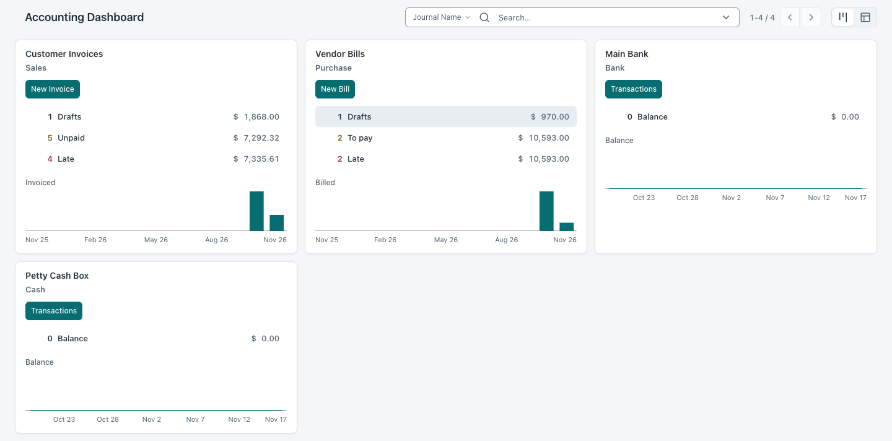

  <picture>
    <source media="(prefers-color-scheme: dark)" srcset="logo-dark.png">
    
  </picture>

<b>IndoERP builds open-source ERP software for everyone. Based in Indonesia.</b>

Our main project is **[ERPForAll](https://github.com/IndoERP/ERPForAll)**, an open-source ERP framework in Rust,
compatible with the way Odoo works:

- Models, views, menus, access rules and addons that extend each other, the way Odoo developers expect.
- A typed ORM on PostgreSQL and a web client of its own.
- Business applications as addons: accounting, inventory, sales and purchase run in early versions today.
- Licensed MIT OR Apache-2.0, self-hosted, built in the open.
- Early development: not ready to run a business yet, and a good time to shape it.

  

### Start here

- **Code:** [IndoERP/ERPForAll](https://github.com/IndoERP/ERPForAll)
- **Documentation:** [indoerp.github.io/ERPForAll](https://indoerp.github.io/ERPForAll/)
- **Questions and ideas:** [Discussions](https://github.com/IndoERP/ERPForAll/discussions)
- **Building addons with AI coding agents:** [erpforall-agent-kit](https://github.com/IndoERP/erpforall-agent-kit)

### Contribute

Pick an issue labelled
[good first issue](https://github.com/IndoERP/ERPForAll/labels/good%20first%20issue) or
[help wanted](https://github.com/IndoERP/ERPForAll/labels/help%20wanted), or say hello in
[Discussions](https://github.com/IndoERP/ERPForAll/discussions). Code, tests, documentation, translations and bug
reports are all welcome. Read [CONTRIBUTING.md](https://github.com/IndoERP/ERPForAll/blob/main/CONTRIBUTING.md) and sign
off your commits (`git commit -s`).

Odoo is a trademark of Odoo S.A. ERPForAll is an independent open-source project, not affiliated with, sponsored by
or endorsed by Odoo S.A. The screenshot shows invented demo data.
